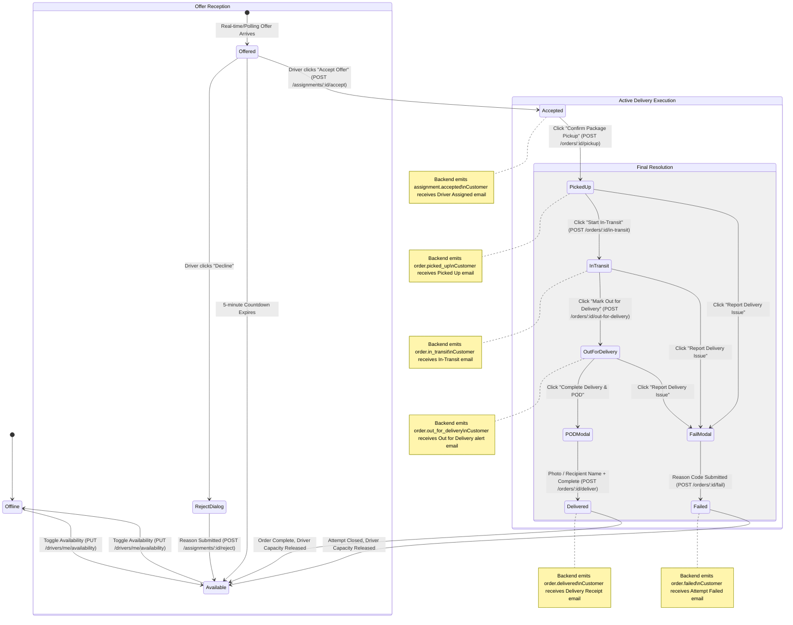

# Frontend Driver Journey Implementation Plan

## Goal Description

In Deliverix, the driver web interface is the primary operational tool used by physical couriers on mobile browsers and desktop to receive offers, communicate availability, execute pickup and active delivery transitions, capture Proof of Delivery (POD) evidence, and report delivery exceptions.

This plan details the complete **Frontend Driver Journey Lifecycle** for `deliverix-web`, fully aligned with:
- **Frontend SRS (v1.0)**: Sections 16 (`DRV-UI-001..010`), 17 (`POD-001..008`), and 21 (`RESP-002..005`).
- **Backend SRS (v2.0)**: Order and Assignment lifecycles, atomic transitions, and outbox notification triggers.
- **Backend APIs**: Versioned `/api/v1` endpoints under `/drivers/me`, `/assignments/:id`, and `/orders/:id`.

---

## User Review Required

> [!IMPORTANT]
> **Automated Customer Email & In-App Notification on Every Driver Action**
> Every status change executed by a driver in the frontend calls a backend workflow mutation that atomically emits an outbox event. The backend notification engine guarantees:
> 1. **Branded Transactional Email**: Delivered to the customer's email address (`customer.email`) for both registered and guest customers.
> 2. **In-App Notification**: Created for registered customer accounts.
> 3. **Frontend Driver Feedback**: The driver UI confirms that the customer has been alerted via visual confirmation toasts (`"Customer notified via email"`).

> [!NOTE]
> **Inline POD Capture & Completion directly in Driver View**
> Drivers previously had to navigate away to the admin/dispatcher `/orders/:id` page to complete deliveries. This plan brings **inline POD capture (Photo upload/camera, Recipient Name) and One-Tap Completion** directly into the driver's active delivery card on `driver-dashboard-view.tsx` and `/drivers/assignments`.

---

## Driver Status Mutations & Customer Notification Matrix

| Driver Frontend Action | API Endpoint Called | Backend Outbox Event | Customer Notification Dispatched | Driver UI Confirmation |
| :--- | :--- | :--- | :--- | :--- |
| **Accept Offer** | `POST /assignments/:id/accept` | `assignment.accepted` | **Driver Assigned Email** (Driver name, phone, tracking link) + In-App alert | Toast: *"Offer accepted! Customer notified of assigned driver."* |
| **Confirm Pickup** | `POST /orders/:id/pickup` | `order.picked_up` | **Order Picked Up Email** (Custody confirmed, timestamp) + In-App alert | Toast: *"Package picked up! Customer notified package is in transit."* |
| **Start In-Transit** | `POST /orders/:id/in-transit` | `order.in_transit` | **In-Transit Email** (Package en route, live tracking) + In-App alert | Toast: *"In-transit started! Customer notified."* |
| **Mark Out for Delivery**| `POST /orders/:id/out-for-delivery`| `order.out_for_delivery` | **Out for Delivery Email** (Proximity alert, be ready) + In-App alert | Toast: *"Out for delivery! Customer proximity alert sent."* |
| **Submit POD & Deliver** | `POST /orders/:id/deliver` | `order.delivered` | **Delivery Receipt Email** (POD summary, delivered timestamp) + In-App alert | Toast: *"Delivery completed! Receipt and proof sent to customer."* |
| **Report Failure Issue** | `POST /orders/:id/fail` | `order.failed` | **Delivery Attempt Failed Email** (Reason code, next steps) + In-App alert | Toast: *"Attempt reported. Customer notified of delivery issue."* |

---

## Driver Journey Lifecycle Frontend Architecture



---

## Detailed Journey Phases

### Phase 1: Driver Availability & Duty State (`DRV-UI-003`)
- **Status Badges**: `Available` (Green), `Assigned` (Blue), `OnDelivery` (Amber), `Offline` (Gray), `Unavailable` (Red).
- **Control Rules**: Driver can manually toggle `Available` &harr; `Offline` / `Unavailable`. When backend state is `Assigned` or `OnDelivery`, availability toggle is disabled with tooltip indicating state is backend-controlled.

### Phase 2: Assignment Offer & Live Countdown (`DRV-UI-004`, `DRV-UI-005`)
- **Offer Banner**: High-priority alert displaying order number, pickup origin, destination, and package summary.
- **Countdown Timer**: Real-time ticker counting down to `offerExpiresAt`. Warns when under 60 seconds remaining.
- **Accept Action**: Immediate pending state preventing duplicate clicks (`DRV-UI-008`). Triggers `assignment.accepted` and notifies customer.
- **Reject Dialog**: Captures reason code/text (e.g., `VEHICLE_ISSUE`, `DISTANCE_TOO_FAR`, `SHIFT_ENDED`) before calling `POST /assignments/:id/reject`.

### Phase 3: Package Pickup (`DRV-UI-006`)
- **State**: `Assigned` &rarr; `PickedUp`.
- **Driver Action**: "Confirm Package Pickup".
- **Customer Notification**: Backend emits `order.picked_up` sending customer custody email.
- **Data Displayed**: Merchant/Origin address, pickup notes/instructions, customer name.

### Phase 4: Active Transportation (`InTransit` & `OutForDelivery`)
- **Phase 4a**: Click "Start In-Transit" (`POST /orders/:id/in-transit`) &rarr; Customer receives in-transit email.
- **Phase 4b**: Click "Mark Out for Delivery" (`POST /orders/:id/out-for-delivery`) &rarr; Customer receives proximity email alert.
- **Customer Contact**: One-tap phone button `tel:${customerPhone}` for driver to call customer on arrival.
- **Navigation Assistance**: External map link (`https://www.google.com/maps/search/?api=1&query=...`) for one-tap turn-by-turn navigation.

### Phase 5 & 6: Proof of Delivery (POD) & Completion (`POD-001..008`)
- **POD Dialog**:
  - Photo Evidence: File upload or mobile camera snap (`POST /files/upload` with `orderId`).
  - Recipient Name: Input field for person who accepted delivery.
  - Submit POD: Calls `POST /orders/:id/proofs`.
- **Complete Delivery**:
  - Submits `POST /orders/:id/deliver` with `If-Match: "${order.version}"` (`completeDelivery`).
  - Backend emits `order.delivered` sending customer delivery receipt email with POD summary.
  - Releases driver back to `Available`.

### Phase 7: Delivery Exception & Failure Modal (`DRV-UI-006`, `ATT-004`)
- **Action**: "Report Issue / Attempt Failed" available in `PickedUp`, `InTransit`, and `OutForDelivery`.
- **Failure Dialog**:
  - Dropdown of valid failure reason codes:
    - `RECIPIENT_UNAVAILABLE`: Recipient not present or not answering.
    - `INCORRECT_ADDRESS`: Delivery address cannot be located.
    - `CUSTOMER_REFUSED`: Recipient rejected package.
    - `ACCESS_DENIED`: Gate code / security access denied.
    - `SAFETY_HAZARD`: Unsafe delivery conditions.
  - Required explanatory text field.
  - Submits `POST /orders/:id/fail` via `failOrder(orderId, { reasonCode, reasonText })`.
  - Backend emits `order.failed` sending customer failure explanation email.

---

## Proposed Changes

### Component 1: Driver API Client Extension

#### [MODIFY] `src/features/drivers/api-me.ts`
Add missing execution endpoints:
- `completeDeliveryOrder(orderId, version)`: Calls `POST /orders/:id/deliver` with version header.
- `failDeliveryOrder(orderId, data)`: Calls `POST /orders/:id/fail` with `{ reasonCode, reasonText }`.
- `uploadDriverProofFile(orderId, file)`: Uploads photo file via `POST /files/upload`.
- `submitDriverProof(orderId, data)`: Submits evidence via `POST /orders/:id/proofs`.
- `getDeliveryFailureReasons()`: Fetches active failure reason codes.

---

### Component 2: Driver Workflow Modals & Dialogs

#### [NEW] `src/features/drivers/components/reject-offer-dialog.tsx`
Modal dialog capturing reason code and notes when a driver declines an assignment offer.

#### [NEW] `src/features/drivers/components/complete-delivery-dialog.tsx`
Comprehensive POD capture dialog supporting:
- Photo capture (camera/upload preview, max 5MB, JPEG/PNG).
- Recipient name input.
- Automatic proof submission + order delivery completion in one unified driver action.

#### [NEW] `src/features/drivers/components/fail-delivery-dialog.tsx`
Dialog for reporting delivery failure with predefined reason codes and explanatory notes.

#### [NEW] `src/features/drivers/components/assignment-countdown.tsx`
Live ticking countdown badge that parses `offerExpiresAt` and alerts the driver of expiring offers.

---

### Component 3: Enhanced Driver Views with Notification Feedback

#### [MODIFY] `src/features/drivers/components/driver-dashboard-view.tsx`
- Integrate `AssignmentCountdown` on offer card.
- Integrate `RejectOfferDialog` on offer decline.
- Add Delivery Milestone Stepper on active delivery card (`Assigned` &rarr; `PickedUp` &rarr; `InTransit` &rarr; `OutForDelivery` &rarr; `Delivered`).
- Add "Complete Delivery & POD" button opening `CompleteDeliveryDialog`.
- Add "Report Issue" button opening `FailDeliveryDialog`.
- Add one-tap phone call (`tel:`) and Google Maps navigation buttons.
- Add customer notification feedback toasts on every mutation completion.

#### [MODIFY] `src/app/(app)/drivers/assignments/page.tsx`
- Sync with enhanced action dialogs and notification toasts so drivers can execute the complete journey from the assignments view.

---

## Verification Plan

### Automated Tests
1. **Playwright E2E Driver Journey Suite**:
   - `e2e/driver-journey.spec.ts`:
     - Test offer display & countdown timer.
     - Test accept assignment & verify status changes to `Assigned` (customer notification triggered).
     - Test pickup transition to `PickedUp` (customer notification triggered).
     - Test transit transition to `InTransit` (customer notification triggered).
     - Test out-for-delivery transition to `OutForDelivery` (customer proximity alert triggered).
     - Test POD submission & delivery completion (customer delivery receipt triggered).
     - Test failure flow with reason code (customer failure alert triggered).
2. **TypeScript Typecheck**:
   ```bash
   npm run typecheck
   ```
3. **Lint**:
   ```bash
   npm run lint
   ```

### Manual Verification
1. Log in with a driver account (`deliveries.execute` permission).
2. Dispatch an order to the driver.
3. Observe offer countdown banner and accept offer &rarr; verify toast confirms customer notification.
4. Advance through Pickup &rarr; In-Transit &rarr; Out-for-Delivery &rarr; verify each action confirms customer notification.
5. Open POD modal, snap/upload proof photo, enter recipient name, and submit completion.
6. Confirm order reaches `Delivered` and driver status returns to `Available`.
